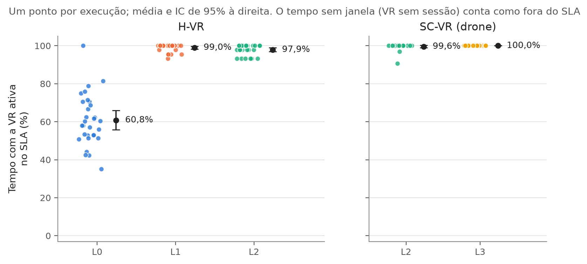
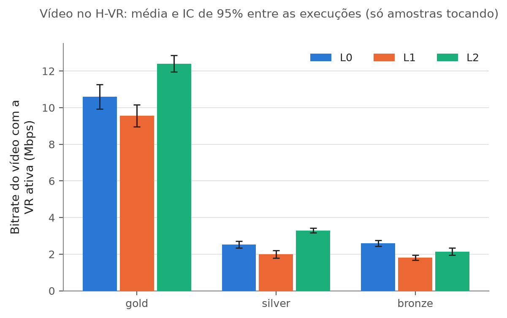

# projeto-5g: VR e vídeo no leilão de fatias 5G

Leilão Vickrey da CPU e da banda das UPFs entre fatias de uma rede 5G, com agentes SPADE e um estrategista LLM. A base é o sistema do artigo de vídeo (tag `v1.0-video`). Esta branch (`vr-photonpath`) acrescenta uma fatia de **realidade virtual** com o PhotonPath e duas peças para protegê-la: um **piso condicional** de recursos e um **agente que dá lance pelo SLA**.

- **O problema:** o vídeo é elástico (o DASH baixa o bitrate e segue tocando), e a VR é inelástica (abaixo de um nível, ela trava).
- **A pergunta:** como pôr a VR num leilão pensado para vídeo sem quebrar nenhuma das duas cargas?

## Resultados (Fase 8, novembro de 2026)

São 5 combinações, com 30 execuções de 15 min cada, intercaladas. Os valores são médias entre as execuções, e a VR é medida pelo tempo ativa no SLA. Os detalhes, os ICs de 95% e os testes estão em [`docs/experimentos.md`](docs/experimentos.md), na seção "Resultados".

| | H-VR L0 | H-VR L1 | H-VR L2 | SC-VR L2 | SC-VR L3 |
| --- | --- | --- | --- | --- | --- |
| Piso da VR | não | sim | sim | sim | sim |
| Agente da VR | utilização | utilização | SLA | SLA | SLA |
| Prompt do LLM | artigo | artigo | artigo | artigo | conhece a VR |
| VR no SLA (tempo ativa) | 60,8% | 99,0% | 97,9% | 99,6% | 100% |
| Da entrada até o SLA (1ª entrada) | 150 s | 1ª janela | 1ª janela | 1ª janela | 1ª janela |
| Banda da VR ativa | 12,8 Mbps | 17,1 Mbps | 9,9 Mbps (piso) | 9,9 Mbps | 9,9 Mbps |
| Vídeo com a VR ativa: gold (H-VR), bombeiros (SC-VR) | 10,6 Mbps | 9,6 Mbps | 12,4 Mbps | 7,2 Mbps | 5,2 Mbps |

1. **Prioridade alta não protege a VR (L0).** Sem piso, ela entra numa UPF no mínimo, perde a sessão por ~70 s e só chega ao SLA depois de 150 s.
2. **O piso protege (L1),** mas com o agente por utilização do artigo a VR acumula recurso, e o vídeo perde até para a L0.
3. **Piso + agente por SLA (L2) serve às duas cargas.** A VR fica no SLA, no piso, e o vídeo tem o melhor bitrate.
4. **Contar ao LLM sobre a VR atrapalha a emergência (L3).** Ele sobe a prioridade do drone, que não precisa dela, em vez da dos bombeiros, que perdem 2 Mbps.





As duas figuras são cópias das que o `analise_fase8.py` grava em `metricas_scripts/resultados/fase8_analise/`.

As tabelas e figuras saem de um script, a partir dos CSVs brutos:

```bash
cd metricas_scripts && ../venv/bin/python analise_fase8.py   # grava tabelas.md, por_execucao.csv e as figuras em resultados/fase8_analise/
```

## Como o sistema funciona

```
  nó blacksabbath (usuários)             nó wb-fibre-01 (UPFs)         ledzeppelin (controle)
 ┌───────────────────────────────┐      ┌─────────────────────┐      ┌─────────────────────────────────┐
 │ ue-video-01/03/05 (DASH)      │─────▶│ upf1 gold           │      │ agentes das fatias (SPADE):     │
 │ ue-vr-07 (PhotonPath, 8 Mbps) │─────▶│ upf2 silver         │◀─────│   vídeo: lance por utilização   │
 │ dash-server, vr-app-01        │◀─────│ upf3 bronze         │      │   VR: lance por SLA (L2)        │
 └───────────────────────────────┘      │ upf4 VR  ← piso     │      │ leiloeiro: Vickrey a cada 30 s, │
                                        │ CPU: resize do pod  │      │   piso com rodada extra (L1+)   │
   Prometheus (UPFs) + exportador       │ banda: Calico       │      │ estrategista LLM: prioridades   │
   da VR (janelas de 12,6 s) ──▶ agentes└─────────────────────┘      └─────────────────────────────────┘
```

Todas as configurações saem do mesmo código; muda só o YAML. Sem a VR (`--sem-vr` e `tipo: video`), o sistema se comporta como a `v1.0-video`.

| Configuração | O que muda no YAML | Pergunta |
| --- | --- | --- |
| L0 | `vr.floor: off`, `vr.agent: utilizacao` | Prioridade alta sozinha protege a VR? |
| L1 | `vr.floor: on` | O piso sozinho resolve? |
| L2 | `vr.agent: sla` | A proposta: a VR no SLA e a sobra para o vídeo? |
| L3 | `vr.llm: vr` | O LLM coordena melhor sabendo da VR? |

## Mapa do repositório

| Pasta | O que tem |
| --- | --- |
| `spade_agents/` | os agentes das fatias, o leiloeiro e o estrategista LLM; a conta do leilão (`leilao.py`), a decisão da VR (`agente_vr.py`) e o prompt (`politica_llm.py`) são funções puras, com testes |
| `vr/` | a calibração da VR (`calibrar.py`, `calibracao.yaml`: o SLA e o piso), o exportador de métricas (`vr_exporter.py`) e o lançador do PhotonPath |
| `client_scripts/` | os clientes de vídeo (DASH) e de VR e os servidores |
| `scripts/` | subir e apagar o testbed, a fila da Fase 8 (`fila_fase8.py`) e o conserto do PFCP das UPFs (`pfcp_upf.py`) |
| `metricas_scripts/` | eventos do teste, coleta, verificador de cada execução (`conferir_execucao.py`) e análise (`analise_fase8.py`); os resultados ficam em `resultados/`, fora do git |
| `tests_configs/` | um YAML por cenário e configuração (`test_config_hvr_l0.yaml`, …) |
| `5Gcore_files/` | o core Open5GS e o registro dos assinantes |
| `photonpath/` | cópia do PhotonPath de Carlos Eduardo Menin (MIT; origem e alterações em `photonpath/ORIGEM.txt`) |
| `docs/` | uma nota por fase, com o que foi feito, os resultados e as decisões |

## As fases

| Fase | Nota | O que é |
| --- | --- | --- |
| 1 | [`validacao-alavancas.md`](docs/validacao-alavancas.md) | as alavancas do leilão (CPU por resize, banda pelo Calico) funcionam na `upf4` |
| 2 | [`vr-no-testbed.md`](docs/vr-no-testbed.md) | a VR ponta a ponta no testbed |
| 3 | [`calibracao-vr.md`](docs/calibracao-vr.md) | o SLA e o piso da VR (0,28 núcleo e 9,9 Mbps) |
| 4 | [`coleta-vr.md`](docs/coleta-vr.md) | a coleta e a análise das métricas da VR |
| 5 | [`leiloeiro-vr.md`](docs/leiloeiro-vr.md) | o piso condicional com rodada extra no leiloeiro |
| 6 | [`agente-vr.md`](docs/agente-vr.md) | o agente da VR por SLA |
| 7 | [`llm-vr.md`](docs/llm-vr.md) | o LLM com a VR (L2 × L3) |
| 8 | [`experimentos.md`](docs/experimentos.md) | as 150 execuções: protocolo, regras de descarte e resultados |

## Como rodar

O cluster é Kubernetes, no namespace `pfsevaldt`; os experimentos rodam na ledzeppelin, num tmux.

```bash
uv venv venv && uv pip install --python venv/bin/python -r requirements.txt   # o ambiente Python do projeto
cp .env.example .env                                                           # as chaves (o .env nunca vai para o git)
bash scripts/build_testbeds.sh                                                 # sobe banco, UPFs, core, assinantes, vídeo e VR
./run_experiment_tmux.sh tests_configs/test_config_hvr_l2.yaml exec01 --completo   # uma execução de 15 min, com a conferência e o veredito
./run_fase8.sh --ciclos 30                                                     # a fila da Fase 8: 5 combinações × 30, intercaladas
./run_fase8.sh --status                                                        # quantas execuções válidas, as falhas e os consertos
bash scripts/delete_testbeds.sh                                                # apaga o testbed
```

Testes das funções puras:

```bash
cd spade_agents && ../venv/bin/python -m unittest test_politica_llm test_agente_vr test_leilao -v   # leilão, agente da VR e prompt do LLM
venv/bin/python -m unittest scripts/test_pfcp_upf.py -v                                              # o leitor do log do PFCP (da raiz)
```

## Créditos

- **PhotonPath:** Carlos Eduardo Menin ([github.com/CarlosMenin/photonpath](https://github.com/CarlosMenin/photonpath)), licença MIT.
- **Sistema de base:** o leilão de fatias de vídeo do artigo (tag `v1.0-video`).
